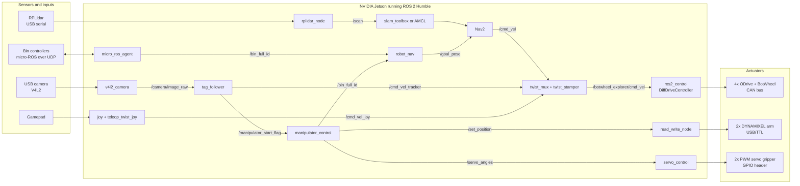

# Autonomous Bin-Collection Robot — ROS 2 Workspace

This is the ROS 2 (Humble) colcon workspace for an autonomous mobile manipulator. The robot drives to a waste bin that has reported itself full, lines up on the bin's AprilTag, picks it up with a two-joint DYNAMIXEL arm and a servo gripper, tips it into its own hopper, puts it back, and heads to the next goal.

> The repository is named `yahboom_car-ros2_ws`, but none of the code targets Yahboom hardware. The robot in this workspace is a custom four-wheel, skid-steer platform. It is driven by ODrive motor controllers over CAN, and its URDF is called `rashwan_bot`.



## Documentation

| Document | What it covers |
|---|---|
| [Hardware](docs/hardware.md) | Every physical component, how it connects to the Jetson, mounting geometry, and the URDF/TF frames that model it |
| [Software architecture](docs/software-architecture.md) | Package inventory (custom vs. vendored), the full node/topic graph, the velocity-command pipeline, and the TF tree |
| [Package reference](docs/packages.md) | Each custom package and node: topics, parameters, internal logic, and the hardware it drives |
| [Mission workflow](docs/mission-workflow.md) | The end-to-end bin-collection sequence, step by step, with timings |
| [Setup & build](docs/setup-and-build.md) | OS and dependency install, Jetson/CAN/serial/PWM preparation, and building the workspace |
| [Operation](docs/operation.md) | Launching the robot for teleop, mapping, localization + navigation, and autonomous missions |
| [Configuration reference](docs/configuration.md) | Every YAML config, launch file, map, and xacro file, plus the key values and where they come from |
| [Troubleshooting & known issues](docs/troubleshooting.md) | Common failures, how to diagnose them, and known defects in the current code |

## Quick start

```bash
# 1. Build (on the robot's Jetson, from the workspace root)
source /opt/ros/humble/setup.bash
rosdep install --from-paths src --ignore-src -r -y
colcon build --symlink-install
source install/setup.bash

# 2. Bring up the CAN bus that the ODrives sit on
sudo ip link set can0 up type can bitrate 250000

# 3a. Build a map: drive around with the gamepad while SLAM runs
ros2 launch my_odrive_botwheel_explorer robot_mapping_launch.launch.py

# 3b. Or run a mission on an existing map (three terminals)
ros2 launch my_odrive_botwheel_explorer robot_localization_launch.launch.py
ros2 launch my_odrive_botwheel_explorer localization_launch.py map:=$PWD/src/ros_odrive/my_odrive_botwheel_explorer/map/map_3.yaml use_sim_time:=false
ros2 launch my_odrive_botwheel_explorer navigation_launch.py use_sim_time:=false
ros2 run tag_follower_pkg tag_follower
ros2 run manipulator_control manipulator_control
```

See [Operation](docs/operation.md) for the full procedure and the safety checks to run first.

## Repository layout

```
src/
├── ros_odrive/
│   ├── my_odrive_botwheel_explorer/   ★ Robot bring-up: URDF, ros2_control, Nav2, SLAM, maps, launch files
│   ├── odrive_ros2_control/             ODrive ros2_control hardware plugin (CAN), upstream
│   ├── odrive_base/                     SocketCAN + CAN-simple message helpers, upstream
│   ├── odrive_node/                     Standalone ODrive CAN node, upstream (not used by the bring-up)
│   └── odrive_botwheel_explorer/        Upstream BotWheel Explorer example (reference only)
├── robot_nav/                         ★ Maps a "bin full" ID to a Nav2 goal pose
├── tag_follower_pkg/                  ★ Final approach to a bin using an AprilTag on the camera feed
├── manipulator_control/               ★ Pick, tip, and return sequence for the arm and gripper
├── servo_control/                     ★ Gripper servos driven by PWM from the Jetson GPIO header
├── DynamixelSDK/                        ROBOTIS SDK; read_write_node and custom messages modified for this robot ★
├── ball_tracker/                        Colour-blob ball follower (third-party demo, not part of the mission)
├── rplidar_ros/                         Slamtec RPLidar driver, upstream
├── micro-ROS-Agent/                     micro-ROS agent (bridges the bin microcontrollers), upstream
└── ros-controls/                        Vendored ros2_control, ros2_controllers, control_msgs, etc. (Humble)
```

★ = written or modified for this robot. Everything else is third-party source, vendored so the workspace builds offline on the Jetson.

## Status

This is research/prototype code. Several parts are hard-coded: the serial ports, the bin coordinates, and the arm angles. Some flows are incomplete; for example, the return-to-dock goal is computed but never published. All of these are listed under [Known issues](docs/troubleshooting.md#known-issues) before anyone relies on them.
