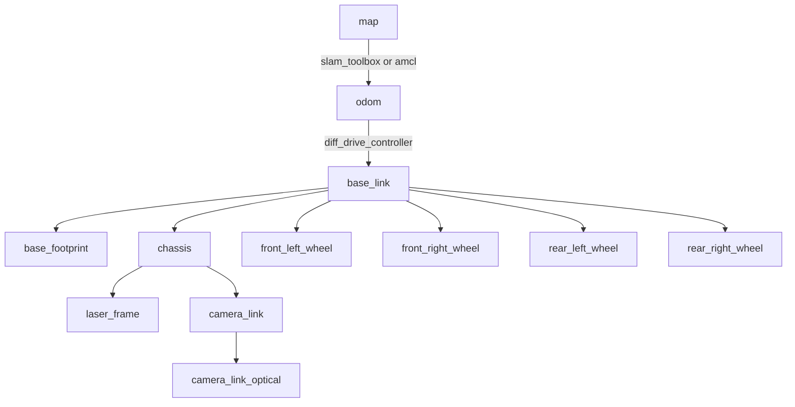

# Hardware

This page describes each physical component of the robot, how it connects to the onboard computer, which software drives it, and how it appears in the robot model (URDF/TF).

Every value here comes from the code and config in this repository. When a fact is **inferred** (for example, from a device path or a library choice) rather than stated outright, it is marked as inferred.

## Component summary

| Subsystem | Hardware | Link to computer | Driver (package → node) | ROS interface |
|---|---|---|---|---|
| Compute | NVIDIA Jetson, Orin series (inferred from USB controller path `platform-3610000.xhci` and the `jetson` maintainer/user) | — | Ubuntu 22.04 + ROS 2 Humble | — |
| Drive base | 4 × ODrive-driven in-wheel motors (BotWheel class), skid-steer | CAN bus via SocketCAN interface `can0` | `odrive_ros2_control` → `ODriveHardwareInterface` inside `ros2_control_node` | `/botwheel_explorer/cmd_vel` (in), `/botwheel_explorer/odom`, `/joint_states`, TF `odom→base_link` |
| 2D LiDAR | Slamtec RPLidar (A1/A2 class; 115200 baud, `Standard` scan mode) | USB-serial adapter | `rplidar_ros` → `rplidar_node` | `/scan` (frame `laser_frame`) |
| Camera | USB UVC camera, 640×480 | USB (V4L2, `/dev/video0` by default) | `v4l2_camera` → `v4l2_camera_node` (namespace `camera`) | `/camera/image_raw` (frame `camera_link_optical`) |
| Arm | 2 × ROBOTIS DYNAMIXEL X-series servos, IDs 1 and 2, driven together as one lift joint | USB↔TTL (U2D2-style) on `/dev/ttyUSB0`, 57600 baud, Protocol 2.0 | `dynamixel_sdk_examples` → `read_write_node` (modified) | `/set_position` (in), `/get_position` (service) |
| Gripper | 2 × hobby PWM servos | Jetson 40-pin header, BOARD pins **33** and **15**, 50 Hz PWM | `servo_control` → `servo_controller` | `/servo_angles` (in) |
| Teleoperation | USB/wireless gamepad (joystick device 0) | USB | `joy` → `joy_node`, `teleop_twist_joy` → `teleop_node` | `/joy`, `/cmd_vel_joy` |
| Bin / collection-unit controllers | Microcontrollers running micro-ROS (inferred: no firmware is in this repo) | Wi-Fi/Ethernet, UDP port 8888 | `micro_ros_agent` | `/bin_full_id` (from bins), `/cu_cmd` (to the collection unit) |
| Remote monitoring | Any PC running Foxglove Studio | Network, WebSocket (port 8765 by default) | `foxglove_bridge` | All topics |

## Drive base

### Mechanical layout

The drive base has four wheels, two per side, and steers like a tank (skid-steer). ROS treats it as a differential-drive robot: both wheels on a side get the same command.

| Quantity | Value | Source |
|---|---|---|
| Wheel radius | 0.0855 m | `config/diffbot_controllers.yaml` (`wheel_radius`), `rashwan_bot_desc.urdf.xacro` (`wheel_radius`) |
| Wheel width | 0.044 m | URDF `wheel_len` |
| Track width (left↔right wheel centres) | 0.552 m | controller `wheel_separation`; in the URDF it equals `base_width + wheel_len + 0.02` = 0.488 + 0.044 + 0.02 |
| Wheelbase (front↔rear axles) | 0.391 m | URDF `wheel2wheel_L` |
| Chassis box (L × W × H) | 0.658 × 0.488 × 0.302 m | URDF `base_length`, `base_width`, `base_height` |
| Chassis ground clearance offset | 0.0477 m | URDF `chassis2wheel` |

### Electrical / bus

- Each wheel has its own ODrive axis on a shared CAN bus. The **CAN node IDs** are set in `description/urdf/diffbot.ros2_control.xacro`:

  | Joint | ODrive `node_id` |
  |---|---|
  | `front_left_wheel_joint` | 0 |
  | `front_right_wheel_joint` | 1 |
  | `rear_left_wheel_joint` | 2 |
  | `rear_right_wheel_joint` | 3 |

  Each ODrive must be configured (with the ODrive GUI or `odrivetool`) to use the matching node ID, the same CAN bit rate as `can0`, and the CAN-simple protocol with periodic encoder-estimate and torque messages enabled.
- The Jetson reaches the bus through a SocketCAN interface named **`can0`**. That is either the Jetson's built-in CAN controller plus a transceiver, or a USB-CAN adapter. The name is set in the `<param name="can">can0</param>` hardware parameter.
- The ODrive firmware works in **turns** and **turns/s**. ROS works in **radians** and **rad/s**. The hardware interface converts between them by dividing or multiplying by 2π (`odrive_hardware_interface.cpp`).

### How motion commands become wheel motion

1. `diff_drive_controller` receives a `TwistStamped` on `/botwheel_explorer/cmd_vel`. It turns that into a wheel speed in rad/s for the left side and the right side, using `wheel_separation` and `wheel_radius`.
2. **`left_wheel_radius_multiplier: -1.0`** flips the sign of the left-side commands. The left motors are mounted mirror-image to the right ones, so without this flip a "forward" command would spin the robot in place.
3. `ODriveHardwareInterface::write()` sends each axis a `Set_Input_Vel` CAN frame with the speed in turns/s. When the controller claims an axis's velocity interface, `perform_command_mode_switch()` puts that axis in `CONTROL_MODE_VELOCITY_CONTROL` and `AXIS_STATE_CLOSED_LOOP_CONTROL`. When the controller releases the interface, or the hardware component is deactivated (for example, on shutdown), the axis goes back to `AXIS_STATE_IDLE`. On a CAN-bus loss, the ODrive's own watchdog (if configured) is what stops the motors.
4. `read()` decodes the `Get_Encoder_Estimates` and `Get_Torques` frames into joint position, velocity, and effort. `joint_state_broadcaster` publishes those on `/joint_states`.
5. The controller is set to `open_loop: true`. That means odometry on `/botwheel_explorer/odom` and the `odom→base_link` TF are integrated from the **commanded** velocities, not the encoder feedback.

> **Mock hardware.** If the xacro argument `use_mock_hardware:=true` is passed, the ODrive plugin is replaced by `mock_components/GenericSystem`, which simply echoes the commands back as state. None of the launch files currently pass that argument through: the lines are commented out, and the xacro default is `false`. The launch-level `use_mock_hardware` argument therefore has no effect.

## LiDAR

| Property | Value |
|---|---|
| Driver | `rplidar_ros` 2.1.4, `rplidar_node` |
| Port | `/dev/ttyUSB0` (`rashwan.launch.py`, `new.launch.py`) or the stable path `/dev/serial/by-path/platform-3610000.xhci-usb-0:2.3:1.0-port0` (`robot_mapping_launch.launch.py`, `robot_localization_launch.launch.py`) |
| Baud rate | 115200 (A1/A2M8 class) |
| Frame | `laser_frame` (`laser` in `new.launch.py`) |
| Mounting (URDF `laser_joint`) | parent `chassis`, xyz = (0.085, 0, 0.4366) m, yaw = π, so the sensor is mounted facing backwards and the URDF compensates for it |
| Consumers | `slam_toolbox` (mapping), `amcl` (localization), Nav2 local and global costmaps (obstacle layers on `/scan`) |

The by-path port names one physical USB port on the Jetson: hub port 2.3. If the LiDAR is plugged into a different port, edit `serial_port` in the launch file or pass `serial_port:=...`.

## Camera

| Property | Value |
|---|---|
| Driver | `v4l2_camera_node`, namespace `camera` |
| Resolution | 640 × 480 (`image_size`) |
| Frame rate | `time_per_frame: [1, 6]`, about 6 fps (kept low to save CPU and bandwidth) |
| Frame ID | `camera_link_optical` |
| Mounting (URDF `camera_joint`) | parent `chassis`, xyz = (0.605, 0, 0.264) m, facing forward. `camera_link_optical` is rotated (−π/2, 0, −π/2) to the ROS optical convention (z forward, x right, y down) |
| Horizontal FOV | 1.089 rad (≈ 62°), used by `ball_tracker/detect_ball_3d` and the Gazebo sensor model |
| Consumer | `tag_follower` (AprilTag detection, mono8), and optionally `ball_tracker` |

The camera sits near the front of the chassis (0.605 m of the 0.658 m length). It sees the AprilTag fixed to each bin during the final approach.

## Manipulator (arm)

The arm is a single lift/tilt joint driven by **two DYNAMIXEL servos working together** (IDs 1 and 2, mounted opposite each other). Both get the same angle on every command.

| Property | Value | Where |
|---|---|---|
| Bus | `/dev/ttyUSB0`, 57600 baud, Protocol 2.0, hard-coded | `DynamixelSDK/dynamixel_sdk_examples/src/read_write_node.cpp` (`DEVICE_NAME`, `BAUDRATE`) |
| Operating mode | 3 = Position Control (control-table address 11) | `setupDynamixel()` |
| Profile velocity / acceleration | 500 / 700 (raw units; addresses 108 / 112) | `setupDynamixel()` |
| Torque | Enabled at start-up for all servos (broadcast ID). Disabled when the node shuts down cleanly | `main()` |
| Angle → tick mapping, ID 1 | 0° → 3784, 180° → 1587 (reversed) | `degreeToPosition()` |
| Angle → tick mapping, ID 2 | 0° → 1845, 180° → 4030 | `degreeToPosition()` |
| Command range | clamped to 0–180° | `degreeToPosition()` |

Named arm poses used by `manipulator_control`:

| Pose | Angle | Meaning |
|---|---|---|
| Home / stowed | 180° | Arm folded up, ready to drive |
| Down / pick | 8° | Arm lowered to grip height, at the bin's handle |
| Drain / tip | 85° | Bin raised and tipped to empty into the robot's collection unit |

> ⚠️ **Port conflict.** The DYNAMIXEL node always opens `/dev/ttyUSB0`. In `rashwan.launch.py` the LiDAR also defaults to `/dev/ttyUSB0`. The mission launch files avoid the clash by pointing the LiDAR at its `by-path` name. Even so, the DYNAMIXEL adapter only gets `ttyUSB0` if it enumerates first. Create udev symlinks for both devices (see [Setup](setup-and-build.md#4-serial-device-names-udev)).

## Gripper

| Property | Value |
|---|---|
| Actuators | 2 × standard hobby servos (0–180°+ range) |
| Signal pins | Jetson 40-pin header, **BOARD** numbering: pin **33** (servo 1) and pin **15** (servo 2) |
| PWM | 50 Hz; duty cycle = `angle / 18 + 2` % → 0° = 2 % (0.4 ms), 90° = 7 % (1.4 ms), 180° = 12 % (2.4 ms) |
| Library | `RPi.GPIO` API. On a Jetson this is supplied by the **Jetson.GPIO** package, which installs an `RPi.GPIO` compatibility module |
| Grip pose | `[170.0, 20.0]` (servo 1, servo 2) |
| Release pose | `[10.0, 190.0]` |

The two servos face each other, so "closed" puts them at opposite ends of their range. Power the servos from a separate 5–6 V supply that shares ground with the Jetson. Do not power them from the Jetson's 5 V header pins. On Jetson dev kits, pins 15 and 33 only output hardware PWM after they are enabled with `sudo /opt/nvidia/jetson-io/jetson-io.py`.

## micro-ROS devices

`micro_ros_agent` is started as `micro_ros_agent udp4 -p 8888 -v6` (by the launch file) or by hand as `micro_ros_agent udp4 --port 8888 --dev 192.168.8.138`. `192.168.8.138` is presumably the Jetson's address on the robot network, and it is the agent IP the microcontroller clients must be set to. It bridges microcontroller clients on the network into the ROS 2 graph. From the topics the robot uses, those clients are:

- **Bin sensors / call buttons** publish `std_msgs/Int32` on `/bin_full_id`. The value is `51 + bin_index` (see [robot_nav](packages.md#robot_nav)). The subscriber uses **best-effort** QoS, which matches the default for micro-ROS publishers.
- **Collection unit (CU)**: `manipulator_control` has a publisher for `std_msgs/Int32` on `/cu_cmd` (1 = open, 0 = close). The calls are commented out right now, so the CU is never commanded.

The microcontroller firmware is **not** part of this repository.

## Robot model and TF frames

The real robot is described by `description/urdf/rashwan_bot.urdf.xacro`. It includes:

| File | Contents |
|---|---|
| `rashwan_bot_desc.urdf.xacro` | `base_link`, `base_footprint`, `chassis`, the four wheel links and continuous joints (macro `diffbot`) |
| `rashwan_inertial.xacro` | Inertia helper macros (`inertial_box`, `inertial_cylinder`, …) |
| `rashwan_lidar.xacro` | `laser_frame` + Gazebo ray sensor |
| `rashwan_camera.xacro` | `camera_link`, `camera_link_optical` + Gazebo camera sensor |
| `rashwan_gazebo.xacro` | Gazebo Classic diff-drive plugin (simulation only; its joint names and dimensions do **not** match the real robot) |
| `diffbot.ros2_control.xacro` | `<ros2_control>` block: ODrive plugin, CAN interface, node IDs |

`diffbot.urdf.xacro` / `diffbot_description.urdf.xacro` describe an older, smaller placeholder base (wheel radius 0.015 m), adapted from the ODrive BotWheel example. Only `new.launch.py` and `my_botwheel_explorer.launch.py` use it.

### TF tree (running system)

- `base_link` sits on the ground plane, centred between the four wheel contact points. `chassis` is offset by −`base_length/2` in x, so its origin is at the rear edge of the body.
- `base_footprint` coincides with `base_link`. SLAM and AMCL are configured to use `base_footprint`; Nav2 costmaps use `base_link`.
- Fixed transforms come from `robot_state_publisher`. Wheel transforms are computed from `/joint_states`.

## Hardware ↔ software cross-reference

| If you change this hardware… | …update this in the software |
|---|---|
| Wheel size | `wheel_radius` in `diffbot_controllers.yaml` **and** `rashwan_bot_desc.urdf.xacro` |
| Track width | `wheel_separation` in `diffbot_controllers.yaml` and `base_width`/`wheel_len` in the URDF |
| ODrive node IDs | `node_id` params in `diffbot.ros2_control.xacro` |
| Motor mounting direction | `left_wheel_radius_multiplier` / `right_wheel_radius_multiplier` |
| CAN interface name | `<param name="can">` in `diffbot.ros2_control.xacro` |
| LiDAR port or mounting | `serial_port` in the launch file; `laser_joint` origin in `rashwan_lidar.xacro` |
| Camera position | `camera_joint` origin in `rashwan_camera.xacro` |
| DYNAMIXEL port, baud rate, or IDs | `DEVICE_NAME`, `BAUDRATE`, `degreeToPosition()` in `read_write_node.cpp`; `ids` in `manipulator_control.py` |
| Arm calibration | The tick constants in `degreeToPosition()`; the pose angles in `manipulator_control.py` |
| Gripper pins or angles | `SERVO_PIN_1/2` in `servo_controller.py`; `grip_servo`/`ungrip_servo` in `manipulator_control.py` |
| Robot footprint | `robot_radius` (currently 0.22 m) in both costmaps in `nav2_params.yaml` |
| Bin locations | `bins_list` in `robot_nav.py` |
| AprilTag size or stopping distance | `size_threshold` parameter of `tag_follower` |
