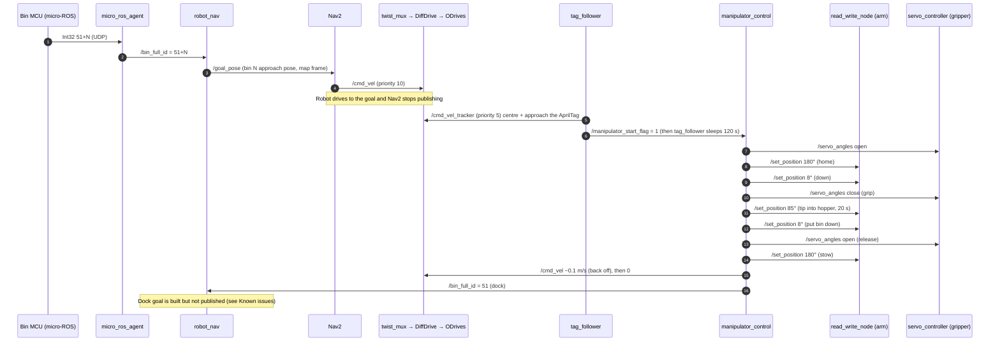

# Mission Workflow: Collecting a Bin

This page follows one complete bin-collection cycle as the code implements it today: which node does what, on which topic, and which hardware moves.

## Overview



## 1. Trigger: a bin reports full

- **Hardware:** a microcontroller on the bin (or a call button) on the same network as the Jetson.
- **Software:** the microcontroller's micro-ROS client publishes `std_msgs/Int32` with value `51 + N` (N = 1…10). `micro_ros_agent`, listening on UDP 8888, re-publishes it on `/bin_full_id`.
- **Manual equivalent** (for testing without bin hardware):

  ```bash
  ros2 topic pub --once /bin_full_id std_msgs/msg/Int32 "{data: 53}"   # bin 2
  ```

  Use the default (reliable) QoS. `robot_nav` subscribes with best-effort, which accepts both reliable and best-effort publishers.

## 2. Navigate to the bin

1. `robot_nav` looks up entry N of `bins_list` and publishes a `PoseStamped` on `/goal_pose` in the `map` frame, with a ±90° yaw.
2. Nav2's `bt_navigator` takes `/goal_pose` as a NavigateToPose goal. It does the same thing as RViz's "2D Goal Pose" tool.
3. Global planning uses NavFn on the static map plus the LiDAR obstacle layer. Local control uses DWB at up to 0.26 m/s and 1.0 rad/s. The goal counts as reached at 0.25 m / 0.1 rad tolerance.
4. Velocity commands flow `velocity_smoother → /cmd_vel → twist_mux → /cmd_vel_mux → twist_stamper → /botwheel_explorer/cmd_vel → diff_drive_controller → ODrive CAN`.
5. Localization comes from AMCL matching `/scan` against the saved map. AMCL publishes `map→odom`, and `diff_drive_controller` publishes `odom→base_link`.

**Hardware involved:** 4 wheel motors and ODrives (CAN), RPLidar (USB serial).

## 3. Final approach on the AprilTag

`tag_follower` runs all the time. While Nav2 is driving, Nav2's `/cmd_vel` (priority 10) outranks `/cmd_vel_tracker` (priority 5) in `twist_mux`. Once Nav2 reaches the goal and stops publishing, the tracker's commands go through after 0.5 s.

1. The camera (`/camera/image_raw`, about 6 fps) is converted to grayscale and searched for tag36h11 tags.
2. The robot turns until the tag is centred within ±5 px, then balances the left and right margins within ±10 px. It creeps forward at 0.1 m/s until the tag's edge length reaches 187 px.
3. Once both conditions hold, it publishes `/manipulator_start_flag = 1`. It then blocks for 120 s, so it neither drives nor re-triggers while the arm is working.

If no tag is visible, `tag_follower` publishes zero velocity. The robot therefore stops at the Nav2 goal and waits; it does not search for the tag.

**Hardware involved:** USB camera, wheel drive.

## 4. Pick, tip, and return

`manipulator_control` runs this blocking sequence (times are cumulative):

| t [s] | Action | Topic → hardware | Arm | Gripper |
|---|---|---|---|---|
| 0 | Open gripper, move arm home | `/servo_angles [10,190]` → GPIO 33/15; `/set_position 180°` → DYNAMIXEL 1, 2 | 180° | open |
| 5 | Lower the arm to the bin handle | `/set_position 8°` | 8° | open |
| 10 | Close the gripper on the bin | `/servo_angles [170,20]` | 8° | closed |
| 20 | Lift and tip the bin over the hopper | `/set_position 85°` | 85° | closed |
| 25–40 | Wait 15 s for the bin to empty | — | 85° | closed |
| 40 | Lower the bin back to the ground | `/set_position 8°` | 8° | closed |
| 45 | Release the bin (command sent 4×) | `/servo_angles [10,190]` | 8° | open |
| 55 | Stow the arm | `/set_position 180°` | 180° | open |
| 60 | Back away from the bin | `/cmd_vel linear.x = −0.1` (effective for ≈0.5 s) | 180° | open |
| 65 | Stop; ask to return to the dock | `/cmd_vel 0`; `/bin_full_id = 51` | 180° | open |
| 70 | Sequence done | — | — | — |

The collection unit (hopper lid) open/close steps (`/cu_cmd`) exist in the code but are commented out. If your hopper has a powered lid, re-enable them around the tipping step.

**Hardware involved:** 2 × DYNAMIXEL (USB-TTL), 2 × PWM servos (GPIO), wheel drive.

## 5. Return to dock

`manipulator_control` publishes `/bin_full_id = 51`, so `robot_nav` sees index 0 (the dock at map (0, 0)). In the current code that branch **does not publish the goal**, so the robot stays where it is until a new `/bin_full_id` arrives. To make the robot return home, uncomment the publish in `robot_nav.py`'s `idx == 0` branch. Or send a goal by hand:

```bash
ros2 topic pub --once /goal_pose geometry_msgs/msg/PoseStamped \
  "{header: {frame_id: map}, pose: {position: {x: 0.0, y: 0.0}, orientation: {w: 1.0}}}"
```

## Timing and failure points

| Stage | Typical duration | What happens on failure |
|---|---|---|
| Navigation | depends on distance (≤ 0.26 m/s) | Nav2 recovery behaviours (spin, back-up, wait). No node watches for a failed result |
| Tag approach | a few seconds | No tag → the robot sits still at the Nav2 goal indefinitely |
| Manipulation | about 70 s | Open-loop: no check that the arm reached its position or that the bin was gripped |
| Return | — | Not automatic (see above) |

The pipeline has no supervisor. A supervisor would track each stage's result, handle timeouts, and queue multiple full bins. Adding one, as a state machine or a Nav2 behaviour tree that uses the `NavigateToPose` action result, is the natural next step. See [Known issues](troubleshooting.md#known-issues).
