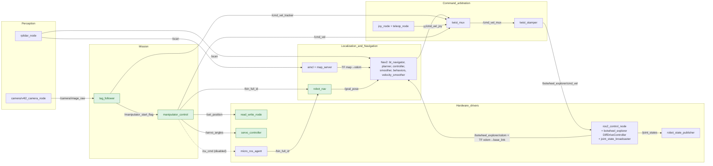
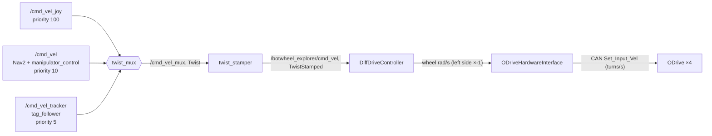

# Software Architecture

## Platform

| Item | Value |
|---|---|
| ROS distribution | ROS 2 **Humble** (vendored ros2_control 2.42, ros2_controllers 2.37, micro-ROS Agent 3.0.6; Humble branches) |
| OS | Ubuntu 22.04 (JetPack 6 on a Jetson) |
| Build tool | `colcon` (`ament_cmake` and `ament_python` packages) |
| Languages | Python (mission logic, vision, gripper), C++ (DYNAMIXEL node, ODrive plugin, LiDAR driver, ros2_control) |

## Package inventory

### Robot-specific packages

| Package | Type | Purpose |
|---|---|---|
| `my_odrive_botwheel_explorer` | ament_cmake (data only) | System bring-up: URDF/xacro, ros2_control and controller config, Nav2 / SLAM / joystick / twist_mux config, saved maps, RViz config, and all robot launch files |
| `robot_nav` | ament_python | Turns a "bin full" ID into a Nav2 goal pose |
| `tag_follower_pkg` | ament_python | Visual servoing to a bin's AprilTag, then triggers the manipulator |
| `manipulator_control` | ament_python | Timed pick → tip → return sequence for arm and gripper |
| `servo_control` | ament_python | Gripper servo PWM through the Jetson GPIO |
| `dynamixel_sdk_custom_interfaces` | ament_cmake (msgs) | `SetPosition`, **`SetMultiplePositions`** (added for this robot), `GetPosition` |
| `dynamixel_sdk_examples` | ament_cmake | `read_write_node`, **rewritten** for this robot: degree-based dual-servo control, profile velocity/acceleration, position mode |

### Third-party packages (vendored source)

| Package(s) | Upstream | Used by the robot? |
|---|---|---|
| `odrive_ros2_control`, `odrive_base` | ODrive Robotics `ros_odrive` | **Yes**: the wheel hardware plugin |
| `odrive_node` | ODrive Robotics `ros_odrive` | No. It is an alternative to `odrive_ros2_control`, and the two cannot run at the same time |
| `odrive_botwheel_explorer` | ODrive Robotics `ros_odrive` | No. It is the upstream example that `my_odrive_botwheel_explorer` was forked from |
| `rplidar_ros` | Slamtec | **Yes**: LiDAR driver |
| `micro_ros_agent` | micro-ROS | **Yes**: bridges the bin microcontrollers |
| `dynamixel_sdk` | ROBOTIS | **Yes**: serial protocol library for the arm |
| `ros-controls/*` (ros2_control, ros2_controllers, control_msgs, control_toolbox, realtime_tools, kinematics_interface, gz_ros2_control, ros2_control_demos) | ros-controls | **Partly**: `controller_manager`, `diff_drive_controller`, `joint_state_broadcaster`, `hardware_interface`. The rest (Gazebo plugins, demos) are not used and can be skipped when building |
| `ball_tracker` | Articulated Robotics (Josh Newans) | No. It is an experimental colour-ball follower, kept as a reference for the vision/follow pattern |

### External dependencies (installed from apt/pip, not in `src/`)

`nav2_bringup` and the Nav2 stack, `slam_toolbox`, `robot_state_publisher`, `xacro`, `v4l2_camera`, `joy`, `teleop_twist_joy`, `twist_mux`, `twist_stamper`, `foxglove_bridge`, `rviz2`, `cv_bridge`, OpenCV, NumPy, the `apriltag` Python module, and `Jetson.GPIO`. See [Setup & build](setup-and-build.md).

## Runtime node graph

Below are the nodes started by the mission bring-up (`robot_localization_launch.launch.py`), plus the Nav2 launches and the two nodes that are started by hand (`tag_follower` and `manipulator_control`).

## Topic catalogue

| Topic | Type | Publisher(s) | Subscriber(s) | Notes |
|---|---|---|---|---|
| `/scan` | `sensor_msgs/LaserScan` | `rplidar_node` | slam_toolbox, amcl, Nav2 costmaps | frame `laser_frame` |
| `/camera/image_raw` | `sensor_msgs/Image` | `v4l2_camera_node` | `tag_follower` (and `ball_tracker` if run) | 640×480, about 6 fps |
| `/bin_full_id` | `std_msgs/Int32` | micro-ROS bin clients; `manipulator_control` (value 51 = "go to dock") | `robot_nav` (best-effort QoS) | value = 51 + index into `bins_list` |
| `/goal_pose` | `geometry_msgs/PoseStamped` | `robot_nav` (`manipulator_control` declares a publisher but never uses it) | Nav2 `bt_navigator` | frame `map` |
| `/cmd_vel` | `geometry_msgs/Twist` | Nav2 `velocity_smoother`; `manipulator_control` | `twist_mux` (input `navigation`, priority 10) | |
| `/cmd_vel_tracker` | `geometry_msgs/Twist` | `tag_follower` | `twist_mux` (input `tracker`, priority 5) | |
| `/cmd_vel_joy` | `geometry_msgs/Twist` | `teleop_node` | `twist_mux` (input `joystick`, priority 100) | only while the enable button is held |
| `/cmd_vel_mux` | `geometry_msgs/Twist` | `twist_mux` | `twist_stamper` | remapped from `cmd_vel_out` |
| `/botwheel_explorer/cmd_vel` | `geometry_msgs/TwistStamped` | `twist_stamper` | `diff_drive_controller` | Humble's diff drive needs stamped input |
| `/botwheel_explorer/odom` | `nav_msgs/Odometry` | `diff_drive_controller` | (TF is what Nav2 uses in practice) | open-loop odometry |
| `/joint_states` | `sensor_msgs/JointState` | `joint_state_broadcaster` | `robot_state_publisher` | 4 wheel joints |
| `/tf`, `/tf_static` | `tf2_msgs/TFMessage` | `robot_state_publisher`, `diff_drive_controller`, slam_toolbox/amcl | everyone | see the [TF tree](hardware.md#tf-tree-running-system) |
| `/robot_description` | `std_msgs/String` | `robot_state_publisher` | RViz, Foxglove | |
| `/map` | `nav_msgs/OccupancyGrid` | slam_toolbox (mapping) or map_server (localization) | Nav2 global costmap, RViz | |
| `/manipulator_start_flag` | `std_msgs/Int32` | `tag_follower` | `manipulator_control` | 1 = start the pick sequence |
| `/set_position` | `dynamixel_sdk_custom_interfaces/SetMultiplePositions` | `manipulator_control` | `read_write_node` | `ids: [1,2]`, `position` in degrees |
| `/get_position` (service) | `dynamixel_sdk_custom_interfaces/GetPosition` | `read_write_node` | — | returns raw ticks |
| `/servo_angles` | `std_msgs/Float64MultiArray` | `manipulator_control` | `servo_controller` | `[angle1, angle2]` in degrees |
| `/cu_cmd` | `std_msgs/Int32` | `manipulator_control` (calls commented out) | collection-unit micro-ROS client | 1 = open, 0 = close |
| `/joy` | `sensor_msgs/Joy` | `joy_node` | `teleop_node` | |

## Velocity command pipeline

All motion goes through one arbitration point, so the joystick can always override the autonomy:

- `twist_mux` forwards the **highest-priority input that has published within its timeout** (0.5 s for all three inputs). The joystick wins whenever its enable button is held. Nav2 beats the tag follower.
- If nothing arrives on `/botwheel_explorer/cmd_vel` for 0.5 s (`cmd_vel_timeout`), the diff-drive controller stops the wheels. That is the main software watchdog.
- Limits are applied at three stages: Nav2 (DWB `max_vel_x` 0.26 m/s, `max_vel_theta` 1.0 rad/s, then `velocity_smoother`), `teleop_twist_joy` scaling (0.5 m/s normal / 1.0 m/s turbo), and finally the diff-drive controller (±1.0 m/s, ±1.0 rad/s, 1.0 m/s² acceleration).

## Control loop rates

| Loop | Rate | Source |
|---|---|---|
| ros2_control `update_rate` (CAN read/write, controller) | **10 Hz** | `diffbot_controllers.yaml` |
| Nav2 controller server | 20 Hz | `nav2_params.yaml` |
| Velocity smoother | 20 Hz | `nav2_params.yaml` |
| SLAM TF publishing | 50 Hz (`transform_publish_period: 0.02`) | `mapper_params_online_async.yaml` |
| Camera | about 6 fps | launch file |
| `tag_follower` | once per camera frame | — |
| `manipulator_control` idle publisher | 10 Hz | timer in node |

A 10 Hz controller loop is low for the drive. It also caps how often odometry and `/joint_states` can update, whatever `publish_rate` (50 Hz) says. Raising it to 50–100 Hz is recommended once CAN bus load allows.

## Launch-file map

All of these live in `src/ros_odrive/my_odrive_botwheel_explorer/launch/`. See [Operation](operation.md) for when to use each one.

| Launch file | URDF | ros2_control | LiDAR | Camera | SLAM | Joystick + mux | Foxglove | Arm + gripper | robot_nav | micro-ROS | RViz |
|---|---|---|---|---|---|---|---|---|---|---|---|
| `robot_mapping_launch.launch.py` | rashwan | ✔ | ✔ (by-path) | ✔ | ✔ mapping | ✔ | ✔ | ✔ | — | — | ✔ |
| `robot_localization_launch.launch.py` | rashwan | ✔ | ✔ (by-path) | ✔ | — | ✔ | ✔ | ✔ | ✔ | ✔ | — |
| `localization_launch.py` | — | — | — | — | map_server + AMCL | — | — | — | — | — | — |
| `navigation_launch.py` | — | — | — | — | Nav2 servers | — | — | — | — | — | — |
| `rashwan.launch.py` | rashwan | ✔ | ✔ (`/dev/ttyUSB0`) | ✔ | ✔ mapping | ✔ | ✔ | — | — | — | ✔ |
| `new.launch.py` | diffbot (placeholder) | ✔ | ✔ (`/dev/ttyUSB0`) | — | — | — | — | — | — | — | ✔ (rplidar config) |
| `my_botwheel_explorer.launch.py` | diffbot (placeholder) | ✔ | — | — | — | — | — | — | — | — | ✔ (needs `ros2_control_demo_description`) |
| `joy_stick.launch.py` | — | — | — | — | — | joystick only, no mux | — | — | — | — | — |

## Design notes

- **ros2_control over a standalone ODrive node.** Using `odrive_ros2_control` means the standard `diff_drive_controller` handles kinematics, limits, odometry, and the command timeout. The custom code never has to deal with the CAN protocol.
- **Two-stage approach to a bin.** Nav2 gets the robot to a pose in front of the bin using the global map. The camera-based `tag_follower` then does the last few decimetres, where map accuracy is not good enough to grip.
- **Topic-level hand-offs instead of actions.** Each stage triggers the next by publishing a topic: bin ID → goal, tag reached → manipulator start, manipulator done → next goal. This keeps the nodes simple. The cost is that nothing confirms a stage finished: no Nav2 result, no arm position check. See [Known issues](troubleshooting.md#known-issues).
